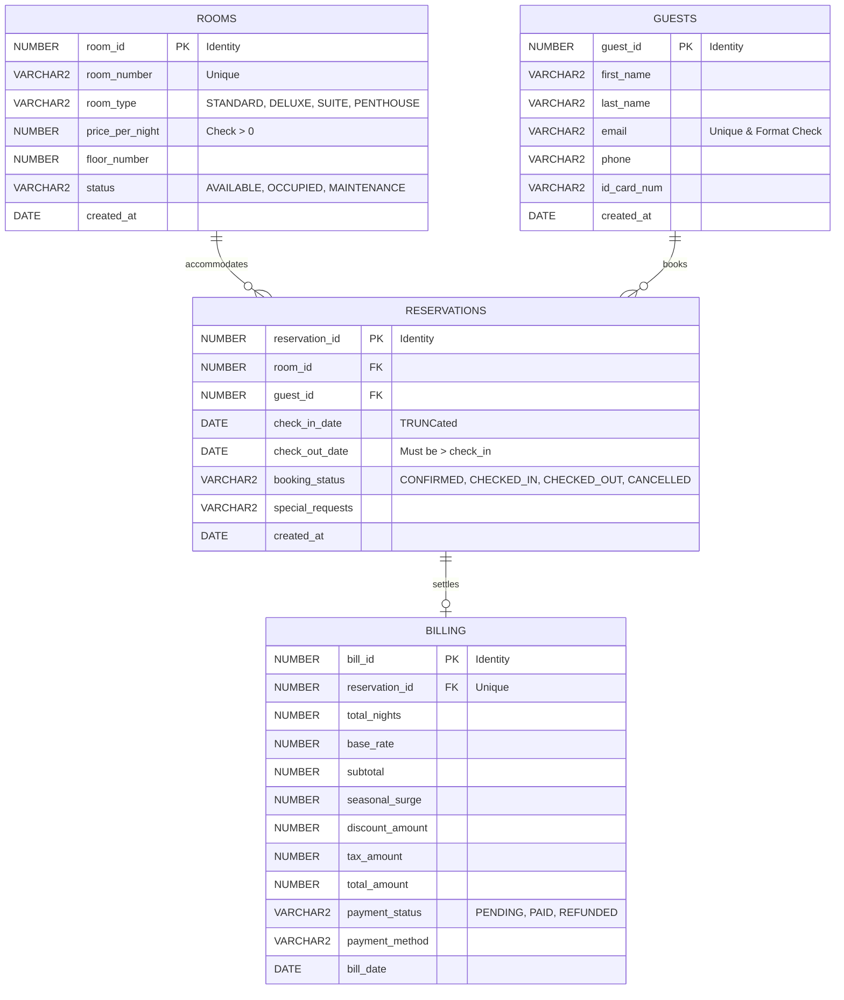

# 🏨 StayLogic: Automated Hotel Room Booking & Management System

> **A production-grade Oracle PL/SQL property management backend engine featuring automated double-booking prevention, mutating table resilience via Compound Triggers, parameterized availability cursors, and dynamic seasonal pricing.**

---

## 📌 1. Project Overview & Architecture

StayLogic is an intermediate-to-advanced Oracle database application engineered to manage hotel inventory, guest reservations, and billing automation entirely within the database engine. It solves critical real-world database concurrency problems, specifically:
- **Zero Double-Bookings Guarantee**: Row and statement-level enforcement preventing conflicting reservations across overlapping date windows.
- **Mutating Table (ORA-04091) Elimination**: Uses an Oracle **Compound Trigger** pattern to eliminate table mutation traps during multi-row or direct DML updates.
- **Dynamic Pricing Engine**: Automatically computes seasonal surges (e.g., peak summer/winter holidays), voucher discounts (`SUMMER10`, `EARLYBIRD15`, `VIP20`), and standard tax rates.



---

## 📁 2. Repository File Structure

| File | Purpose |
| :--- | :--- |
| [`01_schema_ddl.sql`](file:///C:/Users/harsh/.gemini/antigravity/scratch/staylogic/01_schema_ddl.sql) | DDL tables, identity columns, foreign keys, check constraints, composite performance indexes. |
| [`02_staylogic_pkg_spec.sql`](file:///C:/Users/harsh/.gemini/antigravity/scratch/staylogic/02_staylogic_pkg_spec.sql) | Package specification: custom exceptions, record types, constants, public procedures. |
| [`03_staylogic_pkg_body.sql`](file:///C:/Users/harsh/.gemini/antigravity/scratch/staylogic/03_staylogic_pkg_body.sql) | Package body: cursor loops, booking transaction, dynamic billing math, and ASCII folio printer. |
| [`04_compound_trigger.sql`](file:///C:/Users/harsh/.gemini/antigravity/scratch/staylogic/04_compound_trigger.sql) | Automated Shield: 4-stage compound trigger preventing double bookings without ORA-04091. |
| [`05_seed_data.sql`](file:///C:/Users/harsh/.gemini/antigravity/scratch/staylogic/05_seed_data.sql) | High-fidelity sample rooms (Standard to Penthouse), guest profiles, and confirmed bookings. |
| [`06_test_suite.sql`](file:///C:/Users/harsh/.gemini/antigravity/scratch/staylogic/06_test_suite.sql) | Automated test harness executing 7 regression test cases with clear PASS/FAIL reporting. |
| [`07_interactive_cli.sql`](file:///C:/Users/harsh/.gemini/antigravity/scratch/staylogic/07_interactive_cli.sql) | Interactive terminal demo printing live room searches, active reservations, and folios. |
| [`run_all.sql`](file:///C:/Users/harsh/.gemini/antigravity/scratch/staylogic/run_all.sql) | Master one-click deployment runner executing all scripts in order. |

---

## ⚡ 3. Key Technical Challenges Solved

### A. The Mutating Table Trap (ORA-04091)
- **The Problem**: A standard `BEFORE/AFTER INSERT OR UPDATE ON RESERVATIONS FOR EACH ROW` trigger that executes `SELECT ... FROM RESERVATIONS` fails immediately with `ORA-04091: table RESERVATIONS is mutating` during updates or batch operations.
- **The Solution**: StayLogic uses an **Oracle Compound Trigger** (`trg_shield_double_booking`):
  1. `BEFORE STATEMENT`: Flushes an in-memory PL/SQL associative array `g_res_list`.
  2. `BEFORE EACH ROW`: Enforces date bounds (`check_out > check_in` and `check_in >= SYSDATE`).
  3. `AFTER EACH ROW`: Buffers `:NEW.room_id`, `:NEW.check_in_date`, and `:NEW.check_out_date` in memory.
  4. `AFTER STATEMENT`: Evaluates the conflict query against `RESERVATIONS`. At statement completion, the table is **no longer mutating**, allowing clean queries and transaction aborts (`RAISE_APPLICATION_ERROR(-20002)`).

### B. Accurate Date Overlap Mathematics
In hotel management, a guest can check in on the **same afternoon** that another guest checks out in the morning.
The mathematical formula for overlapping intervals \([A_{in}, A_{out}]\) and \([B_{in}, B_{out}]\) without false positives on the boundary is:
$$\text{Overlap} \iff (A_{in} < B_{out}) \land (A_{out} > B_{in})$$

- If Existing Booking is **Oct 10 to Oct 14**, and New Booking is **Oct 14 to Oct 18**:
  - $14 < 14$ is **FALSE**.
  - No conflict is flagged. The booking succeeds seamlessly.

---

## 🚀 4. How to Run

### Option 1: Oracle SQL Developer / SQL*Plus
1. Open your SQL client and connect to your Oracle database schema (Oracle XE, 19c, 21c, 23ai, or Cloud Autonomous DB).
2. Execute the master script:
   ```sql
   @run_all.sql
   ```
3. Check the output in the `Script Output` or terminal console. All 7 test cases will execute and show `[PASS]`.

### Option 2: Oracle APEX Web App in 10 Minutes
1. Log in to [apex.oracle.com](https://apex.oracle.com) (free workspace).
2. Go to **SQL Workshop** > **SQL Scripts** > **Upload** and upload `run_all.sql` (or individual files in numerical order).
3. Click **Run**.
4. Go to **App Builder** > **Create Application** > **From Existing Tables**:
   - Choose `ROOMS` for an Interactive Cards / Cards Grid.
   - Choose `RESERVATIONS` for an Interactive Grid + Calendar view.
   - Choose `BILLING` for an Itemized Invoicing report.
   - In page processes, call `staylogic_pkg.calculate_invoice(:P_RES_ID, :P_PROMO, TRUE)` to calculate totals dynamically!

---

## 💼 5. Resume & Interview Talking Points

- **Resume Bullet**:
  > *"Engineered a robust hotel reservation backend using Oracle PL/SQL, implementing compound triggers to eliminate ORA-04091 mutating table errors, parameterized availability cursors, custom exception frameworks, and a dynamic pricing engine with seasonal surge and voucher validation."*
- **Talking Point in Technical Interviews**:
  > *"When designing concurrent reservation systems in Oracle, standard row-level triggers fail due to ORA-04091 mutating table exceptions. I implemented an Oracle Compound Trigger pattern that buffers modified rows in PL/SQL memory during the row phase and evaluates date-interval overlap logic during the statement completion phase, guaranteeing atomicity and concurrency safety."*
